# Backyard Birds

A [Tesserae](https://github.com/dmellok/tesserae) widget showing the birds [BirdNET-Go](https://github.com/tphakala/birdnet-go) has heard today, illustrated with classic natural history plates by Audubon, Gould, Lear and others.

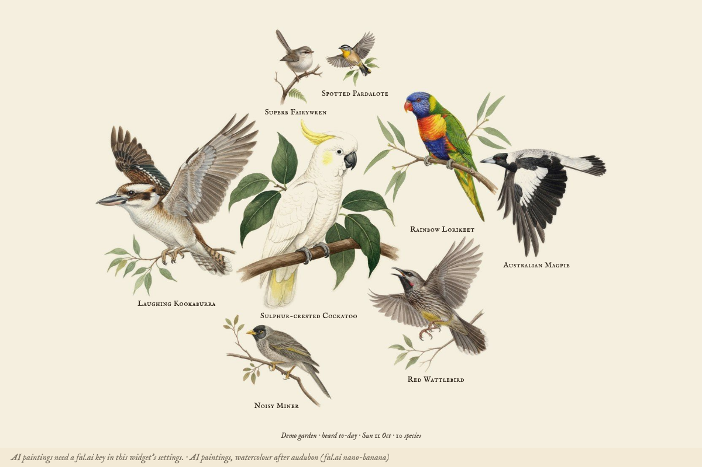

Until you point it at a BirdNET-Go server, it runs a **demo garden**: a believable day of birdsong for wherever the cell's (or the app's) location is, in Australia, Europe or North America, built from the clock so it fills in through the morning. You can try every layout without a microphone.

## Connecting BirdNET-Go

Put BirdNET-Go's address in **BirdNET-Go address**, for example `http://birdnet.local:8080`. The widget reads two endpoints from BirdNET-Go's v2 API:

- `/api/v2/analytics/species/daily`: today's species, with counts per hour, first and last heard, and the new-species flag
- `/api/v2/detections/recent`: the latest individual detections

Both are public unless BirdNET-Go's Private Mode is on. If it is, create an API token in BirdNET-Go and paste it into **BirdNET-Go API token**. The token is only ever sent to the BirdNET-Go address, never to a thumbnail host it links to.

Common names come from BirdNET-Go, so they appear in whatever language BirdNET-Go is set to.

The manifest declares `network:*` rather than a list of hosts, because the BirdNET-Go address is whatever you type in and Tesserae's capability guard matches hosts by name. What the widget actually reaches: your BirdNET-Go address, `commons.wikimedia.org` and `upload.wikimedia.org` for plates, `api.inaturalist.org` and `inaturalist-open-data.s3.amazonaws.com` for photos, and `fal.run` only when the AI picture options are on.

## Layouts

| Layout | What it shows |
| --- | --- |
| Field log | Today's birds as a list: picture, name, when last heard, calls today, with a 24-hour activity strip |
| Latest visitor | The bird just heard, large, beside today's tally |
| Gallery | A card per bird, with a "new today" flag |
| Day chart | Who called in which hour, with optional counts in the cells |
| Book plate | The latest bird as a page from a field guide, with an engraved-style caption |
| Cluster | Today's busiest birds on one page: a specimen sheet of their AI paintings, a blended AI scene, or a numbered montage of their plates and photos |
| Full bleed | The latest bird's picture fills the cell, with one of thirteen caption styles: name band, editorial, field notebook, specimen tag, poster, folio plate, museum label, scientific figure, cyanotype, postage stamp, woodblock print, cameo, Art Nouveau |

The last four full-bleed styles are natural-history pieces. **Folio plate** is a double-ruled page from a Victorian folio, numbered by which bird of the day this was, with an engraved caption. **Museum label** sets the plate beside a collection card in printed field names and handwritten entries. **Scientific figure** draws the bird's calls per hour round a 24-hour dial with a figure caption. **Cyanotype** prints the picture as its own negative, white on Prussian blue, under the Latin name.

Four more frame the bird as an object. **Postage stamp** puts it on a perforated stamp, with the garden as its country and the day's calls as its value. **Woodblock print** gives it a tall title cartouche and a red seal, as on a Japanese kacho-e print. **Cameo** shows it in an oval window on a dark mat, like a Victorian cabinet card. **Art Nouveau** sets it under an arched frame with a title panel.

Every layout adapts to portrait cells. At full bleed, a plate is never cropped: it is fitted whole into the space the caption leaves, and the rest of the cell is filled with the plate's own paper colour.

**Chart labels** puts numbers on the day chart's cells and the field log's activity strip: a count in every cell, or only in each bird's busiest hour.

## Panels

A Tesserae page is composed once and quantised for each panel afterwards, so the widget cannot tell what the panel can show; the **Panel** option says. **Colour** is the default. **16 greys** converts the pictures to greyscale with a gentle contrast stretch. **4 greys** stretches harder and snaps the day chart's heat scale to the panel's own four steps. **Black and white** lifts the mid-tones so a watercolour plate still reads once the panel dithers it, turns the heat scale into hatch patterns, frames the highlights instead of filling them, and thickens the fine serif and handwritten strokes.

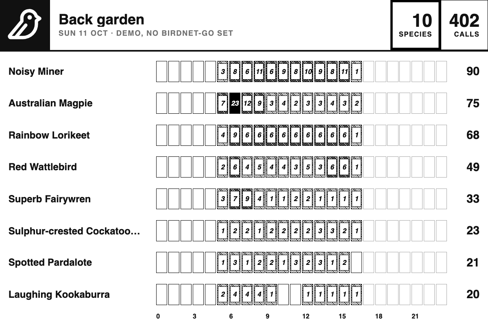

| | |
| --- | --- |
| 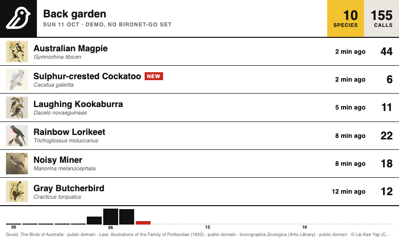 | 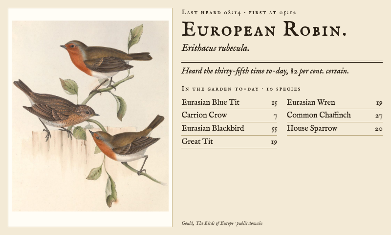 |
| 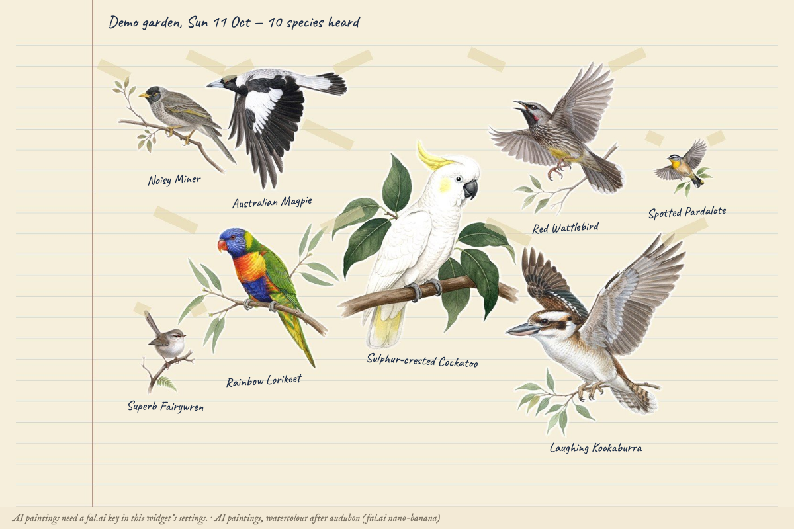 | 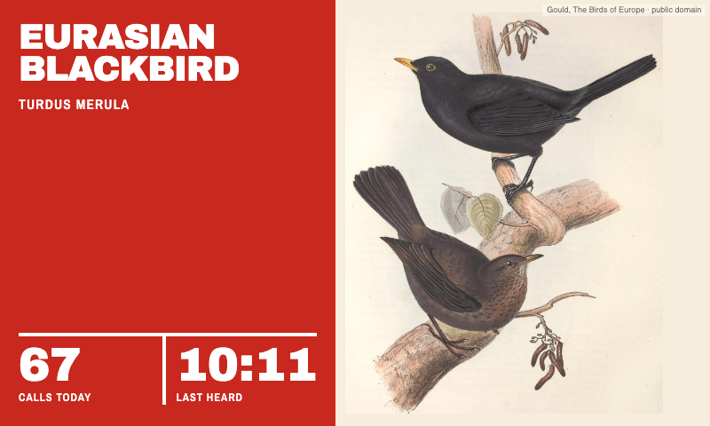 |
| 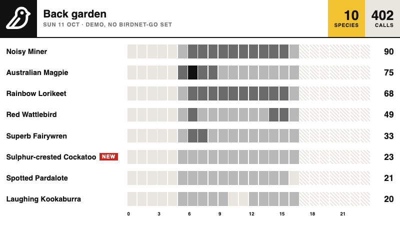 | 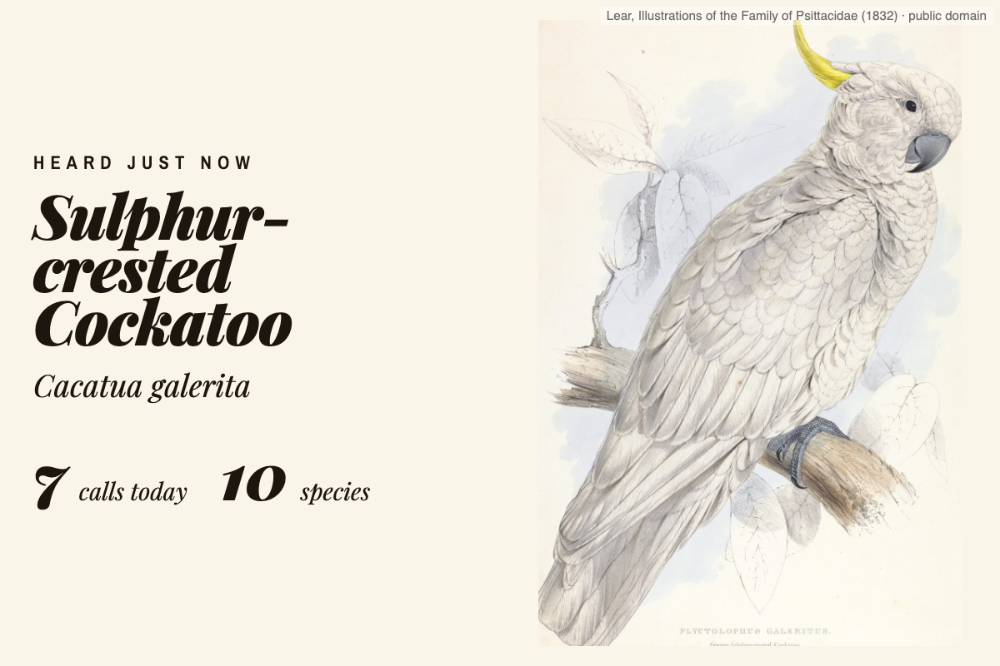 |
| 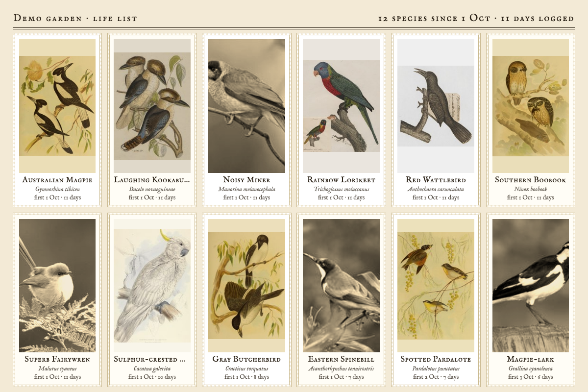 | 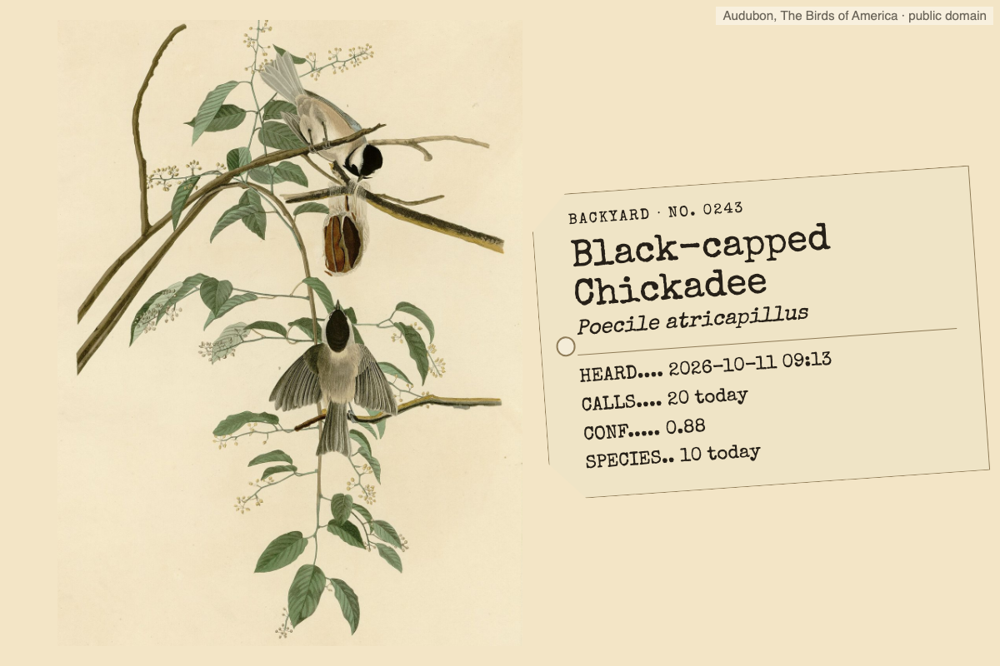 |
| 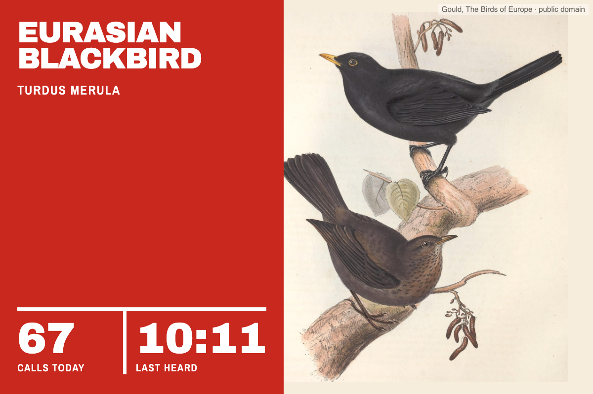 | 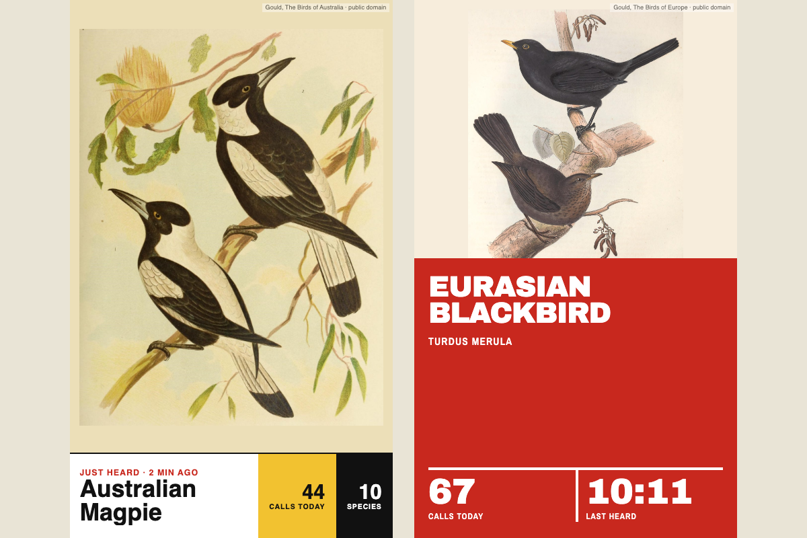 |

## Pictures

- **Classic plates** come from `plates.json`, a reviewed pack of public-domain illustrations on Wikimedia Commons. Each entry records the file, a crop box around the bird and the source book. The widget fetches a plate once, crops and resizes it, and keeps it.
- **Photos** fill the gaps: BirdNET-Go's own species thumbnail, or in demo mode an openly licensed iNaturalist photo. Shown among plates, a photo is toned to a warm monotone so the set still matches; set **Photo colour** to natural colour to leave photos as they are.
- **AI paintings (experimental)** repaint an openly licensed reference photo in the plate style through [fal.ai](https://fal.ai). Each bird is painted once and kept, at most one new painting per refresh and twelve a day, at about US$0.04 a bird. A painting takes longer than Tesserae gives a widget to fetch its data, so it is made in the background: the bird shows a photo with a "Painting the …" note, and the painting appears on a later refresh. If fal.ai refuses (a wrong key, an empty balance), the reason is printed on the panel and that bird is not tried again for six hours. Paintings are credited as AI paintings on the panel. Add a fal.ai key in the widget's settings to use them.

**Art style** picks how AI paintings are made: hand-coloured lithograph after Gould (the default), watercolour after Audubon, Japanese woodblock print, black-ink engraving, linocut or field sketch. Each style keeps its own painting of a bird, so switching back and forth costs nothing after the first time. The engraving and linocut suit black-and-white panels best.

### The cluster layout

The cluster shows the day's busiest birds on one page, in one of two **Cluster styles**. Both need an AI picture option; until a bird is painted, and with AI painting off, the cluster is a numbered montage of the birds' own plates and photos.

**Specimen sheet** (the default) is a page from a field guide: each bird's own AI painting is cut out and printed on one sheet, packed into an oval with the biggest bird in the middle, roughly true to size against each other (from a bundled table of body lengths for common garden birds), each named underneath. It shows up to 24 birds (**Birds in the cluster**), costs nothing beyond the birds' own paintings, and fills in as they are painted, one per refresh. Building a sheet takes a few seconds, so it happens in the background and the previous sheet shows meanwhile.

**Blended scene** shows up to six birds as one picture: once all of them are painted they are arranged in an oval and one more fal.ai pass repaints them together, with one branch, one background and one light. The blend is kept and made again when the busiest birds change, at most as often as **Re-blend the cluster** allows (hourly to daily, three hours by default), at about US$0.04 a blend.

AI paintings are asked for as a single bird and its perch alone on plain paper, so they cut out cleanly for both.

### Managing the paintings

The widget has its own page under **Widgets → Backyard Birds** (`/plugins/backyard_birds/`) listing every painting it has made. From there you can:

- **Repaint** a bird. The current painting is kept as an earlier version, and any earlier version can be brought back or deleted.
- **Delete** a painting. With an AI picture option on, the bird is painted again the next time it is shown.
- **Use instead of the classic plate**, so a painting you like wins over the bird's plate, even with the plain "Classic plates, photos" option.
- **Paint a bird** now, by scientific name and in any art style, to compare a painting with its plate before choosing.
- See the cluster's blended pictures, one per art style, and delete one to have the widget blend the current birds again.
- See today's count against the daily limit, and why a painting failed, with a button to let the widget try again.

A kept painting is also used for a bird without a plate whenever classic plates are on, so turning the AI option off does not throw the paintings away.

Credits for whatever is on screen are printed in the corner or footer.

### The plate pack

The first pack covers 29 common garden species across Australia, Europe and North America. Commons files illustrations as `Category:<scientific name> (illustrations)`, and a sample of common garden birds from seven regions (including Africa, South America and Japan) found illustrations for 50 of 56. So the pack can grow well beyond its first three regions, but each pick needs a person to check it: plates often show several species, and the best-scored file is not always the right bird.

`tools/build_plates.py` does the finding and cropping:

```sh
python tools/build_plates.py --species "Turdus merula" "Parus major"   # propose
open tools/out/review.html                                             # look
python tools/build_plates.py --accept "Turdus merula=1" "Parus major"  # take a pick
```

It keeps public-domain still images only, prefers known plate series (Audubon, Gould, Naumann, Lear, Keulemans, Thorburn, Siebold's *Fauna Japonica* and others), and crops each to the drawing, ignoring plate marks and captions. Pull requests that add reviewed plates are welcome.

## Fonts

The caption styles bundle Playfair Display, Caveat, IM Fell English, Archivo Black and Archivo Narrow (SIL Open Font License) and Special Elite (Apache 2.0); their licences are in `fonts/`. Only the faces a style needs are sent with a render. On the black-and-white panel setting the fine serif and handwritten strokes are thickened so they survive dithering.

## Not yet

- Interface words ("just heard", "calls today") are English only; bird names follow BirdNET-Go.
- The demo garden covers Australia, Europe and North America; elsewhere it falls back to North America.

## Licence

AGPL-3.0-or-later. Plates are public domain; photos and fonts keep their own licences, as credited.
